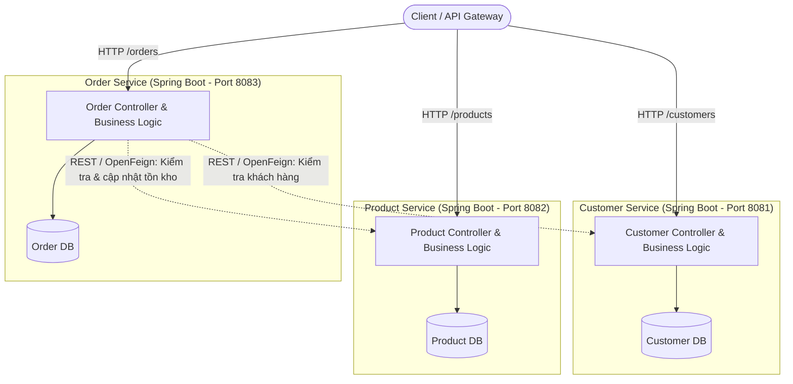
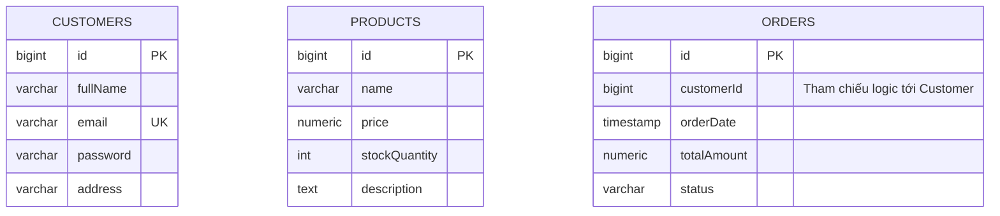
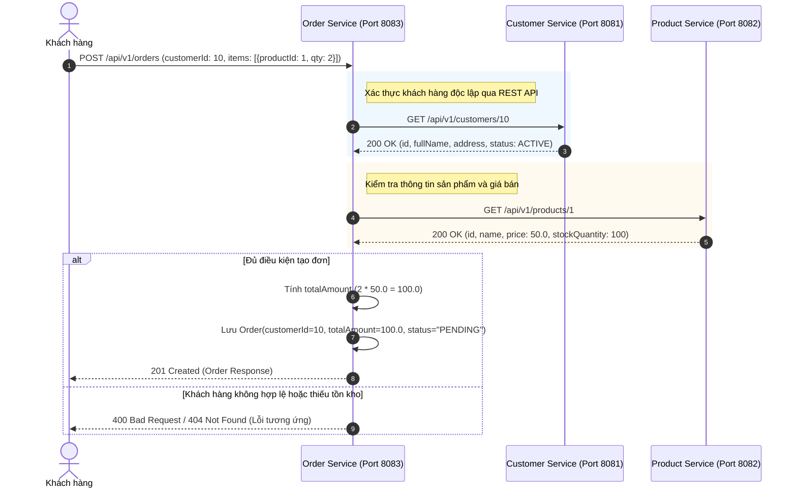

# THIẾT KẾ KIẾN TRÚC HỆ THỐNG TMĐT MICROSERVICES

Tài liệu thiết kế chi tiết việc phân tách hệ thống Thương mại điện tử (TMĐT) thành 3 dự án Spring Boot độc lập theo nguyên lý kiến trúc Microservices.

---

## 1. TỔNG QUAN KIẾN TRÚC (ARCHITECTURE OVERVIEW)

Hệ thống được chia thành 3 dịch vụ độc lập tương ứng với 3 domain cốt lõi:
1. **Customer Service**: Quản lý thông tin khách hàng, định danh và tài khoản.
2. **Product Service**: Quản lý danh mục hàng hóa, giá bán và số lượng tồn kho.
3. **Order Service**: Quản lý quy trình đặt hàng, tính toán đơn hàng và trạng thái đơn hàng.

### Ngăn xếp công nghệ chuẩn hóa (Tech Stack):
* **Spring Boot**: 4.x / 3.x (Spring Boot 4.1.1)
* **Java SDK**: JDK 17
* **Cơ sở dữ liệu**: PostgreSQL (mỗi service 1 database riêng: `customer_db`, `product_db`, `order_db`)
* **Build Tool**: Gradle (Gradle Wrapper)
* **Thư viện tích hợp**: Lombok, Spring Data JPA, Jakarta Validation, Spring Security Crypto (BCrypt)
* **Containerization**: Docker & Docker Compose


### Sơ đồ kiến trúc tổng quan



---

## 2. THIẾT KẾ CÁC THỰC THỂ & CƠ SỞ DỮ LIỆU ĐỘC LẬP

### 2.1. Customer Service (`customer-service`)
* **Nhiệm vụ**: Xác thực, đăng ký, cập nhật và quản trị hồ sơ khách hàng.
* **Database**: `customer_db` (PostgreSQL / MySQL)
* **Thực thể**: `Customer`

#### Chi tiết thuộc tính `Customer`:
| Tên thuộc tính | Kiểu dữ liệu | Ràng buộc | Diễn giải |
| :--- | :--- | :--- | :--- |
| `id` | `Long` | PK, Auto Increment | Mã định danh duy nhất của khách hàng |
| `fullName` | `String` | Not Null, Max 100 | Họ và tên khách hàng |
| `email` | `String` | Not Null, Unique, Max 100 | Địa chỉ email (dùng để đăng nhập/liên hệ) |
| `password` | `String` | Not Null | Mật khẩu (đã được hash BCrypt/Argon2) |
| `address` | `String` | Max 255 | Địa chỉ mặc định của khách hàng |

---

### 2.2. Product Service (`product-service`)
* **Nhiệm vụ**: Quản lý sản phẩm, đơn giá và số lượng tồn kho.
* **Database**: `product_db`
* **Thực thể**: `Product`

#### Chi tiết thuộc tính `Product`:
| Tên thuộc tính | Kiểu dữ liệu | Ràng buộc | Diễn giải |
| :--- | :--- | :--- | :--- |
| `id` | `Long` | PK, Auto Increment | Mã định danh duy nhất của sản phẩm |
| `name` | `String` | Not Null, Max 200 | Tên sản phẩm |
| `price` | `BigDecimal` | Not Null, >= 0 | Đơn giá hiện tại của sản phẩm |
| `stockQuantity`| `Integer` | Not Null, >= 0 | Số lượng sản phẩm còn trong kho |
| `description` | `String` | Text | Mô tả chi tiết sản phẩm |

---

### 2.3. Order Service (`order-service`)
* **Nhiệm vụ**: Tiếp nhận đơn hàng, lưu vết thanh toán, theo dõi trạng thái đơn hàng.
* **Database**: `order_db`
* **Thực thể chính**: `Order` (cùng `OrderItem` mở rộng để đáp ứng thực tế TMĐT)

#### Chi tiết thuộc tính `Order`:
| Tên thuộc tính | Kiểu dữ liệu | Ràng buộc | Diễn giải |
| :--- | :--- | :--- | :--- |
| `id` | `Long` | PK, Auto Increment | Mã định danh duy nhất của đơn hàng |
| `customerId` | `Long` | Not Null, Index | **Mã tham chiếu khách hàng** (không dùng Foreign Key DB) |
| `orderDate` | `LocalDateTime` | Not Null | Ngày và giờ tạo đơn hàng |
| `totalAmount` | `BigDecimal` | Not Null, >= 0 | Tổng giá trị đơn hàng |
| `status` | `String` / `Enum`| Not Null | Trạng thái (`PENDING`, `CONFIRMED`, `SHIPPED`, `CANCELLED`) |

*(Mở rộng thực tế cho chi tiết mặt hàng: `OrderItem` gồm `id`, `orderId`, `productId`, `quantity`, `unitPrice`)*.

---

### 2.4. Sơ đồ Thực thể Dữ liệu (Entity Relationship Diagram - Tách rời theo DB)



> **Lưu ý quan trọng**: Không tồn tại quan hệ khóa ngoại (Foreign Key constraint) ở mức Database giữa bảng `ORDERS` và bảng `CUSTOMERS` hay `PRODUCTS`, vì chúng nằm ở các máy chủ/schema Database hoàn toàn tách biệt.

---

## 3. PHÂN TÍCH CHUYÊN SÂU: TẠI SAO ORDER CHỈ LƯU `customerId` MÀ KHÔNG LƯU CẢ ĐỐI TƯỢNG `Customer`?

Đây là câu hỏi trọng tâm khi chuyển từ tư duy Monolith sang Microservices và Domain-Driven Design (DDD). Dưới đây là các lý do kỹ thuật và nghiệp vụ cốt lõi:

### 3.1. Đảm bảo nguyên lý Bounded Context & Loose Coupling (Khớp nối lỏng)
* Trong Domain-Driven Design (DDD), `Customer` và `Order` thuộc hai **Bounded Context** khác nhau:
  * `Customer Context`: Quan tâm đến danh tính, hồ sơ, bảo mật tài khoản và xác thực.
  * `Order Context`: Quan tâm đến quy trình thanh toán, giao dịch, vận chuyển và doanh thu.
* Nếu `Order` chứa cả đối tượng `Customer`, `Order Service` sẽ bị phụ thuộc chặt chẽ vào cấu trúc dữ liệu của `Customer Service`. Bất kỳ thay đổi nào trong `Customer` (ví dụ: thêm ngày sinh, avatar, đổi mật khẩu) đều có thể buộc `Order Service` phải sửa code, migrate dữ liệu hoặc tái triển khai.
* Bằng cách chỉ lưu `customerId`, `Order Service` chỉ giữ **khóa định danh (Identity Reference)**, đảm bảo tính độc lập tối đa.

---

### 3.2. Nguyên lý Single Source of Truth (SSOT) & Tính nhất quán của dữ liệu (Data Consistency)
* `Customer Service` là **nguồn dữ liệu chân thực duy nhất (Single Source of Truth)** cho mọi thông tin về khách hàng.
* **Nguy cơ bất đồng bộ dữ liệu (Data Inconsistency)**:
  * Nếu `Order` lưu toàn bộ thông tin `Customer` (`email`, `fullName`, `password`, `address`), khi khách hàng cập nhật email hoặc đổi mật khẩu trong `Customer Service`, dữ liệu này trong bảng `Order` sẽ trở nên **lạc hậu (stale/outdated)**.
  * Để đồng bộ hóa, hệ thống sẽ phải quét hàng triệu bản ghi đơn hàng lịch sử để cập nhật lại thông tin khách hàng, gây lãng phí tài nguyên khổng lồ và rất dễ phát sinh lỗi phân tán (distributed transaction failure).

---

### 3.3. An toàn thông tin & Bảo mật (Security & Principle of Least Privilege)
* Thực thể `Customer` chứa các dữ liệu cực kỳ nhạy cảm:
  * `password` (mật khẩu đã hash), token xác thực, thông tin cá nhân (PII).
* `Order Service` và nhân sự/hệ thống quản lý đơn hàng **không có lý do nghiệp vụ** nào để biết hoặc lưu trữ `password` của người dùng.
* Việc nhân bản cả đối tượng `Customer` sang `Order Service` vi phạm nghiêm trọng **Nguyên tắc đặc quyền tối thiểu (Principle of Least Privilege)** và tiêu chuẩn an toàn thông tin (như GDPR, PCI-DSS), làm tăng bề mặt tấn công nếu cơ sở dữ liệu `order_db` bị rò rỉ.

---

### 3.4. Tối ưu hóa dung lượng lưu trữ & Hiệu năng hệ thống (Storage & Performance)
* Một khách hàng có thể tạo hàng trăm hoặc hàng nghìn đơn hàng trong suốt vòng đời tài khoản.
* Nếu mỗi bản ghi `Order` đều sao chép toàn bộ object `Customer`:
  * Dung lượng lưu trữ bị lãng phí nghiêm trọng (Data Redundancy).
  * Kích thước các index và bảng `orders` tăng vọt, làm chậm các truy vấn tìm kiếm, thống kê và sao lưu dữ liệu.
* Chỉ lưu `customerId` (8 bytes với `BIGINT`) là giải pháp tối ưu nhất cho hiệu năng và lưu trữ.

---

### 3.5. Phân biệt giữa "Thông tin khách hàng hiện tại" và "Snapshot thông tin giao hàng"
* Một câu hỏi thường gặp: *Nếu khách hàng đổi địa chỉ nhà, đơn hàng cũ có bị đổi địa chỉ theo không?*
* **Giải pháp chuẩn trong Microservices TMĐT**:
  1. `Order` lưu `customerId` để liên kết logic với người sở hữu đơn hàng.
  2. Với các thông tin cần giữ nguyên theo thời điểm chốt đơn (như: địa chỉ nhận hàng, tên người nhận, số điện thoại lúc đặt), `Order Service` sẽ lưu trữ một **Snapshot giao hàng** riêng biệt (ví dụ: `shippingAddress`, `recipientName`, `recipientPhone`).
  3. Tuyệt đối **không copy nguyên vẹn đối tượng `Customer`**, vì đối tượng `Customer` chứa bản chất thực thể sống (lifecycle của user), trong khi đơn hàng cần tính bất biến của hợp đồng giao dịch.

---

### Bảng so sánh tổng hợp:

| Tiêu chí | Lưu cả đối tượng `Customer` | Chỉ lưu `customerId` (Kèm Shipping Snapshot nếu cần) |
| :--- | :--- | :--- |
| **Mức độ phụ thuộc** | Rất cao (Tight coupling) | Rất thấp (Loose coupling) |
| **Tính độc lập Service** | Thay đổi ở Customer ảnh hưởng Order | Hoàn toàn độc lập |
| **Tính nhất quán dữ liệu** | Dễ bị lệch dữ liệu khi user cập nhật profile | Đảm bảo tính duy nhất (Single Source of Truth) |
| **Bảo mật** | Nguy cơ lộ thông tin nhạy cảm (`password`) | An toàn, không chứa thông tin nhạy cảm |
| **Hiệu năng & Lưu trữ** | Tốn dung lượng, bảng bị phình to | Tối ưu dung lượng, truy vấn nhanh |
| **Độ phức tạp bảo trì** | Khó bảo trì, tốn công đồng bộ | Đơn giản, chuẩn chuẩn mực Microservices |

---

## 4. KỊCH BẢN TƯƠNG TÁC KHI TẠO ĐƠN HÀNG (SEQUENCE FLOW)

Dưới đây là luồng xử lý khi khách hàng đặt hàng mà không vi phạm nguyên tắc tách biệt:



---

## 5. CẤU TRÚC DỰ ÁN ĐỀ XUẤT (PROJECT STRUCTURE)

Hệ thống được tổ chức thành 3 thư mục dự án Spring Boot độc lập (Multi-module hoặc 3 Git Repositories riêng biệt):

```text
ecommerce-microservices/
├── customer-service/                 # Spring Boot Project 1
│   ├── src/main/java/com/ecommerce/customer/
│   │   ├── controller/CustomerController.java
│   │   ├── entity/Customer.java
│   │   ├── repository/CustomerRepository.java
│   │   └── service/CustomerService.java
│   └── src/main/resources/application.yml (cấu hình customer_db)
│
├── product-service/                  # Spring Boot Project 2
│   ├── src/main/java/com/ecommerce/product/
│   │   ├── controller/ProductController.java
│   │   ├── entity/Product.java
│   │   ├── repository/ProductRepository.java
│   │   └── service/ProductService.java
│   └── src/main/resources/application.yml (cấu hình product_db)
│
└── order-service/                    # Spring Boot Project 3
    ├── src/main/java/com/ecommerce/order/
    │   ├── client/CustomerClient.java (OpenFeign gọi Customer Service)
    │   ├── client/ProductClient.java  (OpenFeign gọi Product Service)
    │   ├── controller/OrderController.java
    │   ├── entity/Order.java
    │   ├── repository/OrderRepository.java
    │   └── service/OrderService.java
    └── src/main/resources/application.yml (cấu hình order_db)
```
